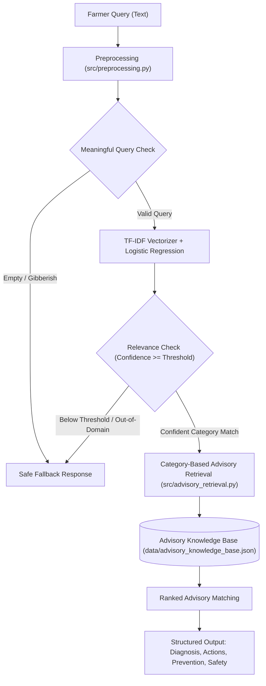

# 🌾 AI-Based Farmer Query Support and Advisory System (KisanSetu)

An intelligent, lightweight decision-support system that classifies farmer agricultural queries and retrieves context-aware actionable advisories. Built using **Python**, **Pandas**, **Scikit-learn (TF-IDF + Logistic Regression)**, **Joblib**, **Streamlit**, and **Pytest**.

---

## 📌 Project Overview & Problem Statement

Farmers often face urgent crop management challenges spanning insect attacks, fungal diseases, nutrient deficiencies, irrigation timing, and post-harvest grain preservation. Navigating technical agronomic manuals can be daunting. 

**KisanSetu** provides:
1. **Intelligent Query Categorization**: Rapidly maps natural language queries into five core agricultural management categories using TF-IDF n-grams and Logistic Regression.
2. **Relevance Validation & Safe Fallback**: Guardrails against low-confidence classifications, ambiguous queries, and out-of-domain requests, preventing misleading recommendations and guiding farmers to extension officers and the Kisan Call Center.
3. **Structured Context-Aware Advisory**: Maps recognized concerns to specific immediate management actions, long-term preventative measures, and chemical/field safety protocols.
4. **Interactive Web Interface**: A clean, accessible Streamlit UI for farmers, extension workers, and students.

---

## 🏗️ Architecture & Pipeline



### Core Components
- **`src/preprocessing.py`**: Normalizes case, removes punctuation, collapses whitespace, and filters uninformative tokens while preserving agricultural terms.
- **`src/train.py`**: Trains the `TfidfVectorizer` (unigrams + bigrams) and `LogisticRegression` (balanced class weighting) on stratified splits and saves the model artifact using `joblib`.
- **`src/advisory_retrieval.py`**: Loads the trained model and knowledge base, verifies relevance thresholds, calculates class probability distributions, and retrieves the most specific advisory.
- **`app.py`**: Modern Streamlit web application with sample questions, interactive sliders, confidence meters, and knowledge base search.
- **`tests/test_pipeline.py`**: Comprehensive Pytest suite testing preprocessing, data integrity, model training, and fallback mechanisms.

---

## 📁 Repository Structure

```
ai-farmer-advisory-system/
├── app.py                         # Streamlit interactive web application
├── requirements.txt               # Project dependencies
├── .gitignore                     # Git ignore rules
├── README.md                      # Complete project documentation
├── data/
│   ├── farmer_queries.csv         # Labeled query dataset (illustrative synthetic)
│   └── advisory_knowledge_base.json # Structured agricultural advisory records
├── models/
│   ├── farmer_intent_model.joblib # Serialized model pipeline & class labels
│   └── farmer_intent_model_metrics.json # Actual test set evaluation metrics
├── src/
│   ├── __init__.py
│   ├── preprocessing.py           # Text cleaning & validation
│   ├── train.py                   # Model training and evaluation pipeline
│   └── advisory_retrieval.py      # Category matching & fallback engine
└── tests/
    ├── __init__.py
    └── test_pipeline.py           # Unit tests
```

---

## 📊 Dataset & Knowledge Base Disclaimer

> [!IMPORTANT]
> **Dataset Transparency**: The dataset (`data/farmer_queries.csv`) contains **250 illustrative synthetic agricultural queries** (50 per category) crafted to capture typical farmer vernacular across five distinct categories. It is designed for educational prototyping, query categorization demonstration, and decision-support modeling. It is **not** an expert-verified clinical agronomic database.
>
> In real farm operations, farmers should consult certified agronomists or their local **Krishi Vigyan Kendra (KVK)** before applying concentrated chemical pesticides.

### Categories Covered:
1. `crop_disease`: Blights, rusts, powdery mildew, damping-off, wilt diseases.
2. `pest_management`: Stem borers, aphids, whiteflies, caterpillars, mites, termites.
3. `soil_and_fertilizer`: NPK balance, soil pH correction, zinc/iron/boron deficiency.
4. `irrigation_and_water`: Critical watering stages, drip irrigation maintenance, waterlogging drainage.
5. `weather_and_harvest`: Maturity indicators, safe moisture grain storage, frost and storm protection.

---

## 🚀 Quickstart & Installation

### 1. Clone or Open the Repository
```bash
git clone https://github.com/iamsatyam12345-beep/ai-farmer-advisory-system.git
cd ai-farmer-advisory-system
```

### 2. Install Dependencies
```bash
python -m pip install -r requirements.txt
```

### 3. Train the Model
Run the training script to generate the model bundle and display actual evaluation metrics:
```bash
python -m src.train
```

### 4. Run Unit Tests
Execute the automated test suite using pytest:
```bash
pytest -v
```

### 5. Launch the Streamlit Web Application
```bash
streamlit run app.py
```
Or with python module runner:
```bash
python -m streamlit run app.py
```
Open your browser at `http://localhost:8501`.

---

## 🛡️ Safe Fallback Mechanism

When a farmer submits an unclear, out-of-domain, or very low-confidence question (e.g. *"what is cryptocurrency?"*, *"xyz"*, or blank input):
- The system **blocks** arbitrary classification.
- It displays a safe fallback card prompting the farmer for key details:
  - Specific crop name (e.g., wheat, rice, tomato)
  - Observed visual symptoms (e.g., yellow spots, wilting, leaf holes)
  - Management domain (disease, insect pest, fertilizer dose, irrigation)
- Directs the user to the toll-free **Kisan Call Center: 1800-180-1551**.

---

## 📜 License
This project is open-source and intended for educational and decision-support research.
